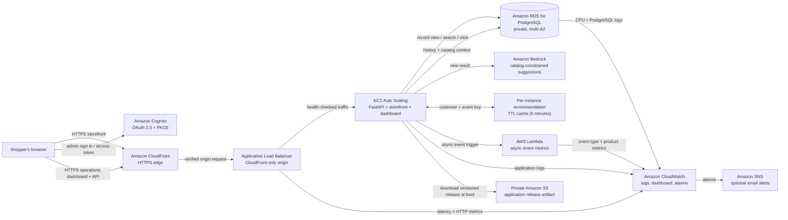

# Northstar Goods — Personalized Storefront

Northstar now opens as a shopper-facing outdoor and camera gear store. The home page has a real storefront layout, category browsing, search, sorting, product detail pages, a persistent shopping bag, and recommendations that respond to recent views. Its catalog has eighteen sample products across photography, outdoor, and accessories. Store operations are separate at `web/dashboard.html`; the Terraform stack places both experiences behind CloudFront and an Application Load Balancer, runs them on EC2, and adds Cognito, RDS, Bedrock recommendations for signed-in dashboard users, event-driven Lambda metrics, and CloudWatch alarms.

The storefront opens locally with an eighteen-product demo catalog and product photography. Browsing history and the bag are saved in that browser. The checkout is intentionally a demonstration only: there is no inventory reservation, order service, or payment processing. The AWS operations dashboard uses Cognito and has separate navigation from the store.

On the local storefront, recommendation picks use the most recently viewed category as a simple on-device demo. On the operations dashboard, authenticated live recommendations use the customer's recent event history and Amazon Bedrock against the database catalog. Live personalized recommendations have not yet been integrated into the anonymous storefront API.

## Why this project

As products and categories trend, a product-only shopping experience can make customers search manually for items that fit their needs. When shoppers cannot find relevant products, they may leave without buying, and businesses miss sales.

Northstar demonstrates a more personalized flow: the store records customer views and searches, keeps customer behavior and catalog data in a relational database, and provides the relevant context to a generative model when it needs to make suggestions. The model does **not** start with knowledge of a particular store's products or its customers. The application supplies that context from its own data. A short-lived cache can reuse recommendations for the same recent behavior, and CloudWatch can help the team monitor recommendation performance and emerging activity.

## Project explanation

The traditional product-only approach asks shoppers to find items themselves. As new products and categories trend, it becomes harder to keep recommendations relevant; customers can spend time searching, leave without buying, and cost the business a potential sale. Personalization uses the customer's own recent interests to make discovery easier.

The web application runs on EC2 instances, with an Application Load Balancer distributing requests and health-checking the application as traffic changes. When a shopper views a product, searches, or opens a recommendation, the API records that event in Amazon RDS for PostgreSQL. Its relational tables connect customer behavior with products in the store catalog.

When a recommendation is needed, the application reads the customer's recent browsing/search context and candidate products from RDS, then asks Amazon Bedrock to select relevant products from that supplied catalog. For example, camera and hiking interest can help Bedrock rank a catalog camera, lens, or camera bag. The application—not Bedrock—supplies the store-specific products and customer history. As more consented activity is collected, the prompt can include richer, recent context. Bedrock is not fine-tuned on this data and the application rejects product IDs that are not in its catalog.

Repeated recommendations can be served from a short-lived cache to reduce model calls, latency, and cost. Lambda runs only when the application invokes it after recording a customer event; that function publishes event metrics to CloudWatch. CloudWatch tracks event volume, clicks/impressions, request latency, errors, and database health, and raises alarms for sustained degradation or unusual activity. The business goal is better discovery, a smoother customer experience, and more conversions; those outcomes must be measured with verified orders and controlled experiments rather than assumed from a model response.

## Architecture



The application instances and database sit in private subnets across two Availability Zones. The public ALB accepts connections only from CloudFront's origin-facing address range and only forwards requests carrying the per-deployment origin verification header. CloudFront terminates public HTTPS; its connection to the ALB uses HTTP inside the AWS network. Database access is limited to the application security group. EC2 uses an instance role and Systems Manager rather than SSH keys.

### End-to-end request and data flow

1. A shopper opens the CloudFront HTTPS URL and signs in through Cognito's hosted sign-in page. The browser uses OAuth authorization code flow with PKCE; the API validates the Cognito access token and derives the customer identity from its verified `sub` claim.
2. The browser sends product recommendation and event requests to the same-origin API. CloudFront routes them through the ALB to a healthy EC2 application instance.
3. The FastAPI application stores customer searches, product views, recommendation impressions, and recommendation clicks in RDS PostgreSQL. The database is relational: customer events reference product records and are indexed by customer and time.
4. For a recommendation request, the application retrieves that customer's recent views, searches, and purchase history (when supplied by a trusted order integration), along with available catalog items from RDS. It passes only that context and the catalog to Bedrock. Bedrock is instructed to choose IDs from the supplied catalog; the application checks the returned IDs and scores before displaying them.
5. Valid results are cached in memory on the EC2 instance for up to five minutes. The cache key includes the latest relevant customer event, so new browsing/search activity naturally results in a new recommendation request. This cache is per instance, not shared across the Auto Scaling group; a future shared cache could use ElastiCache.
6. After an event is committed to RDS, the application asynchronously invokes a small Lambda function to publish event-count metrics. Lambda runs only when invoked. The application and AWS services also produce logs and infrastructure metrics in CloudWatch.
7. A CloudWatch dashboard shows event volume, ALB latency/errors, and RDS CPU. Alarms cover sustained API errors/latency, high database CPU, low recommendation click-through rate (when there is enough traffic), unusual camera interest, and Lambda metric errors. An optional SNS email subscription sends notifications.

### What is real and what is illustrative

- The storefront in `web/index.html` works locally with the sample catalog and needs no AWS credentials. The product detail view is `web/product.html`; the shopping bag is `web/cart.html`.
- The operations dashboard is a separate page at `web/dashboard.html`. Terraform also deploys the authenticated FastAPI API, an EC2 Auto Scaling group, a private multi-AZ PostgreSQL database, Cognito, Bedrock access, an event-metrics Lambda, and CloudWatch monitoring.
- The database is seeded with eighteen example products at application startup. Replace the seed catalog in `backend/app.py` and add a controlled import/update workflow for a real store catalog.
- The local storefront's bag and browsing history use browser storage only. The authenticated dashboard can record searches, product views, recommendation impressions, and clicks. **Verified purchase ingestion is intentionally not exposed as a customer-submitted event**: connect a trusted checkout/order webhook or server-side order service before using sales/conversion reporting. The database and metrics schema reserve the `purchase` event for that integration.
- Recommendation summaries are generated by Bedrock from store data supplied in each request; the model is not fine-tuned on the store and does not automatically discover its catalog.
- The CloudWatch event counters are asynchronously delivered and can be delayed or retried. Use the database as the source of truth for reconciled business reporting.
- The shopper storefront is separate from store operations. Its demo checkout does not create orders or collect payment. Connecting a real checkout, catalog inventory, and anonymous-shopper recommendation API is a follow-up integration. Store-wide dashboard analytics are limited to Cognito users in the `store-admins` group.

## Deploy to AWS

This is a production-oriented **reference deployment**, not a substitute for reviewing your account limits, compliance requirements, data retention, network policy, model access, incident response, and cost plan. Applying this Terraform creates billable infrastructure. In particular, the two NAT Gateways, public ALB, CloudFront distribution, two minimum EC2 instances, Multi-AZ RDS instance, backups, logs, and Bedrock usage can cost money even with light traffic. Check the AWS Pricing Calculator before deployment.

### 1. Prepare tools, account, and model access

Install AWS CLI v2 and Terraform 1.8 or later. Configure credentials for a dedicated deployment role with permission to create the resources in `infra/`, and verify the account:

```powershell
aws configure
aws sts get-caller-identity
terraform version
```

In the Amazon Bedrock console in `us-east-1`, confirm that `amazon.nova-lite-v1:0` is available to your account. Choose another supported model and change `bedrock_model_id` in `infra/terraform.tfvars` if needed. The EC2 role is scoped to the configured model ARN.

### 2. Create a private remote Terraform state bucket

Terraform state contains infrastructure details and generated database credentials. Keep it out of source control and use a versioned, encrypted, private state bucket. Create a globally unique name and retain it when the application is removed:

```powershell
$StateBucket = "northstar-tfstate-<account-id>-<unique-suffix>"
aws s3api create-bucket --bucket $StateBucket --region us-east-1
aws s3api put-public-access-block --bucket $StateBucket --public-access-block-configuration BlockPublicAcls=true,IgnorePublicAcls=true,BlockPublicPolicy=true,RestrictPublicBuckets=true
aws s3api put-bucket-versioning --bucket $StateBucket --versioning-configuration Status=Enabled
aws s3api put-bucket-encryption --bucket $StateBucket --server-side-encryption-configuration '{"Rules":[{"ApplyServerSideEncryptionByDefault":{"SSEAlgorithm":"AES256"}}]}'
Set-Location "D:\The Comparison King\infra"
Copy-Item .\backend.hcl.example .\backend.hcl
```

Edit `infra/backend.hcl` with the actual unique bucket name. The backend enables S3 lock files. Do not enable public access or put credentials in this file.

### 3. Configure and review Terraform

```powershell
Set-Location "D:\The Comparison King\infra"
Copy-Item terraform.tfvars.example terraform.tfvars
```

Edit `terraform.tfvars`. Set a unique lowercase `project_name`, select a Bedrock model available in this region, and optionally set `alert_email`. Configure the S3 backend before initialization:

```powershell
terraform init -backend-config=backend.hcl
terraform fmt -recursive
terraform validate
terraform plan -out=northstar.tfplan
```

Read the complete plan and cost impact before applying. The stack provisions:

- A VPC with public ALB subnets and private application/database subnets across two AZs, per-AZ NAT gateways for resilient outbound access, and an S3 gateway endpoint.
- CloudFront HTTPS, an ALB restricted to CloudFront origins, an encrypted private S3 deployment-artifact bucket, and EC2 instances with IMDSv2, Systems Manager access, encrypted storage, and automatic CPU-based scaling.
- An encrypted, private PostgreSQL RDS instance with Multi-AZ failover, backups, CloudWatch PostgreSQL logs, enhanced monitoring, and deletion protection. RDS manages its master secret; Terraform creates a separate application database login secret.
- Cognito hosted UI sign-in and a public OAuth client that uses PKCE. User self-sign-up is disabled; only users in the `store-admins` group can read store-wide analytics.
- Narrow application and Lambda IAM roles, a Bedrock invocation policy, an asynchronous custom-metrics Lambda, CloudWatch dashboards/alarms, an SNS alarm topic, and an optional email subscription.

### 4. Create AWS resources

Only after reviewing the plan, apply it:

```powershell
terraform apply northstar.tfplan
terraform output storefront_url
terraform output dashboard_url
terraform output cognito_user_pool_id
terraform output cloudwatch_dashboard_name
```

CloudFront distribution deployment can take several minutes. Wait for the distribution to finish deploying and for both application targets to pass the ALB health check.

### 5. Create a sign-in account and test the app

The Cognito user pool accepts administrator-created users only. Create a user using an email address you can access; Cognito sends a temporary password:

```powershell
$PoolId = terraform output -raw cognito_user_pool_id
aws cognito-idp admin-create-user --user-pool-id $PoolId --username "you@example.com" --user-attributes Name=email,Value=you@example.com Name=email_verified,Value=true --desired-delivery-mediums EMAIL
aws cognito-idp admin-add-user-to-group --user-pool-id $PoolId --username "you@example.com" --group-name store-admins
```

Open `storefront_url` to browse the store demo, view product pages, and add items to the local demo bag. Checkout does not place an order. Open `dashboard_url` to sign in to store operations and change the temporary password if prompted. Search for a product or open a recommendation, then refresh the dashboard. Authenticated dashboard events will be stored in RDS, recommendations will be generated by Bedrock, and CloudWatch event metrics will arrive asynchronously. To receive alarm email, confirm the SNS subscription message sent to `alert_email`.

For administrators, inspect the CloudWatch dashboard named by `cloudwatch_dashboard_name`. The initial traffic baseline for anomaly detection is learned over time; do not expect anomaly alarms to be meaningful immediately after deployment.

### 6. Update the application

The application files are archived, versioned in the private S3 bucket, and downloaded by EC2 during instance startup. After changing source files, run `terraform plan` and `terraform apply`; the changed release hash updates the launch template and triggers an Auto Scaling instance refresh. Review health and application logs in CloudWatch after the refresh.

### 7. Tear down safely

The database and load balancer have deletion protection enabled and the database retains a final snapshot. To remove the stack, first set `deletion_protection = false` in `infra/storage.tf` and `enable_deletion_protection = false` in `infra/compute.tf`, apply those changes, and then review and apply a destroy plan:

```powershell
terraform plan -destroy -out=northstar-destroy.tfplan
terraform apply northstar-destroy.tfplan
```

Keep or separately remove the final RDS snapshot, versioned state bucket, and any old versioned application artifacts according to your retention policy. They may continue to incur storage charges. Do not delete the state bucket until the environment is fully removed and its state is no longer needed.

## Run locally

Open the project `index.html` or `web/index.html` in a modern browser for the storefront. Open `web/dashboard.html` for the separate operations dashboard; without Terraform-generated Cognito configuration it uses sample data. The production EC2 startup script writes `web/config.js` for the deployed dashboard.

For local backend development, create a Python 3.12 virtual environment, install `backend/requirements.txt`, provide the AWS/database/Cognito environment variables described in `infra/user_data.sh.tftpl`, and run:

```powershell
python -m uvicorn app:app --app-dir backend --reload
```

The API stores its schema and eighteen seed products at startup. A local database, valid Cognito access token, Bedrock model permission, and the event-metrics Lambda ARN are needed to exercise live endpoints.

Run the focused API and Lambda tests from `backend`:

```powershell
Set-Location "D:\The Comparison King\backend"
python -m unittest discover -s tests -v
```

## Important production follow-ups

Before using this with a real store, ingest the real catalog and verified orders through trusted server-side integrations; add catalog management and migrations; configure consent, data minimization, retention/deletion policies, and database restore drills; review Cognito account policies/MFA; and test load, Bedrock output quality, abuse limits, privacy, and account-specific AWS quotas. The dashboard's product/event data remains a small reference catalog until those integrations are built.
