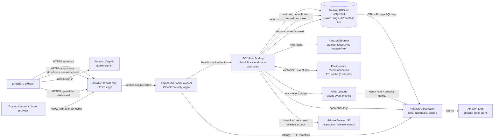

# Northstar Goods — Personalized Storefront

[Resume bullets, project impact, and interview talking points](./RESUME.md)

Northstar is a sample outdoor and camera-gear store with an eighteen-product catalog, category browsing, search, product pages, a browser-local bag, and a separate Cognito-protected operations dashboard. In the deployed environment, the storefront reads its catalog and recommendations from the FastAPI service and PostgreSQL; views, searches, impressions, and recommendation clicks are written to RDS. Recommendations use Amazon Bedrock only after a visitor has browsing/search history; a new visitor sees top-rated catalog picks without an initial model call.

The storefront creates an anonymous, random, HTTP-only session cookie. It is pseudonymous, not an account identity; shoppers do not need to sign in. In direct-file offline preview, the local sample catalog and on-device recommendations are clearly labeled. The checkout remains a demo: no payment is collected, and the browser cannot submit purchase events. A trusted server-to-server order webhook can record verified orders after a separate checkout/payment integration is built and configured.

## Why this project

As products and categories trend, a product-only shopping experience can make customers search manually for items that fit their needs. When shoppers cannot find relevant products, they may leave without buying, and businesses miss sales.

Northstar demonstrates a more personalized flow: the store records customer views and searches, keeps customer behavior and catalog data in a relational database, and provides the relevant context to a generative model when it needs to make suggestions. The model does **not** start with knowledge of a particular store's products or its customers. The application supplies that context from its own data. A short-lived cache can reuse recommendations for the same recent behavior, and CloudWatch can help the team monitor recommendation performance and emerging activity.

## Project explanation

The traditional product-only approach asks shoppers to find items themselves. As new products and categories trend, it becomes harder to keep recommendations relevant; customers can spend time searching, leave without buying, and cost the business a potential sale. Personalization uses the customer's own recent interests to make discovery easier.

The web application runs on EC2 instances, with an Application Load Balancer distributing requests and health-checking the application as traffic changes. When a shopper views a product, searches, or opens a recommendation, the API records that event in Amazon RDS for PostgreSQL. Its relational tables connect customer behavior with products in the store catalog.

When a shopper has browsing or search history, the application reads that recent context and candidate products from RDS, then asks Amazon Bedrock to select relevant products from the supplied catalog. For example, camera and hiking interest can help Bedrock rank a catalog camera, lens, or camera bag. The application—not Bedrock—supplies the store-specific products and customer history, and rejects product IDs that are not in the catalog. Visitors without history receive top-rated catalog picks without a Bedrock request. Consent, data minimization, and retention requirements must be set for the real business before collecting real customer data.

Repeated recommendations can be served from a short-lived cache to reduce model calls, latency, and cost. Lambda runs only when the application invokes it after recording a customer event; that function publishes event metrics to CloudWatch. CloudWatch tracks event volume, clicks/impressions, request latency, errors, and database health, and raises alarms for sustained degradation or unusual activity. The business goal is better discovery, a smoother customer experience, and more conversions; those outcomes must be measured with verified orders and controlled experiments rather than assumed from a model response.

## Architecture



The application instances and database sit in private subnets across two Availability Zones. The public ALB accepts connections only from CloudFront's origin-facing address range and only forwards requests carrying the per-deployment origin verification header. CloudFront terminates public HTTPS; its connection to the ALB uses HTTP inside the AWS network. Database access is limited to the application security group. EC2 uses an instance role and Systems Manager rather than SSH keys.

### End-to-end request and data flow

1. A shopper opens the HTTPS storefront. The API creates an opaque random session cookie marked `HttpOnly` and `SameSite=Lax`; production also marks it `Secure`. Customer account login is not required for browsing. Administrators sign in separately through Cognito's OAuth authorization-code flow with PKCE.
2. The storefront fetches the catalog from RDS through the API and records product views, searches, recommendation impressions, and clicks against that session. The server derives the session identity only from its cookie; the browser cannot submit a purchase event.
3. For a new session, the API returns top-rated catalog picks without invoking Bedrock. Once a visitor has history, it supplies recent activity and available catalog items to Bedrock. Results are validated and cached in process for five minutes; a database-backed per-session limit caps recommendation requests at eight per minute. The in-memory cache is not shared between EC2 nodes.
4. When an order is completed by a separately configured trusted checkout/order service, that service posts to `/api/webhooks/orders` with an HMAC-SHA256 signature, timestamp, and unique event ID. The API rejects invalid/stale signatures, unknown catalog IDs, malformed data, and changed payloads reusing an event ID. It commits the order and purchase events to RDS in one transaction; a duplicate delivery is idempotent. The webhook records an order but does not capture payment or implement checkout.
5. After customer or purchase activity is committed, the API asynchronously invokes Lambda to publish event metrics to CloudWatch. CloudWatch also receives application, load balancer, and database telemetry and can route alarms through SNS.

### What is real and what is illustrative

- The storefront in `web/index.html` works locally with the sample catalog and needs no AWS credentials. The product detail view is `web/product.html`; the shopping bag is `web/cart.html`.
- The deployed storefront reads its catalog from `/api/store/catalog`, issues an anonymous session through `/api/store/session`, and records shopper activity through `/api/store/events`. A separate recommendation endpoint uses Bedrock after there is session history; it enforces a database-backed session quota and CloudFront WAF adds an IP-based edge limit.
- The operations dashboard is a separate page at `web/dashboard.html`. Terraform deploys the FastAPI API, an EC2 Auto Scaling group, a private single-AZ PostgreSQL database, Cognito-protected admin access, Bedrock, an event-metrics Lambda, CloudFront WAF rate limiting, and CloudWatch monitoring.
- The database is seeded with eighteen example products at application startup. Replace the seed catalog in `backend/app.py` and add a controlled import/update workflow for a real store catalog.
- The storefront bag remains in browser storage and checkout is still a demo. Product views, searches, recommendation impressions, and clicks use a random, HTTP-only session cookie in the deployed app. **Purchase events are accepted only through the HMAC-authenticated server-to-server order webhook**; there is no browser purchase API.
- Recommendation summaries are generated by Bedrock from store data supplied in each request; the model is not fine-tuned on the store and does not automatically discover its catalog.
- The CloudWatch event counters are asynchronously delivered and can be delayed or retried. Use the database as the source of truth for reconciled business reporting.
- The store does not include a payment provider, inventory reservation, or production checkout adapter. Build a trusted integration that sends completed order events only after your chosen provider confirms payment. Store-wide dashboard analytics are limited to Cognito users in the `store-admins` group.

## Deploy to AWS

This is a cost-conscious **portfolio deployment**, not a highly available production setup. Applying Terraform creates billable resources. With the default `us-east-1` settings, budget roughly **$90–$160/month** at low traffic before variable data transfer, CloudFront requests, Bedrock tokens, and optional alert delivery. This is an indicative estimate, not a quote; use the AWS Pricing Calculator with your region and expected usage before applying. The ALB, one NAT Gateway, one always-on EC2 instance, private RDS, CloudFront/WAF, public IPv4 addresses, logs, and backups all have charges even when nobody visits. NAT and ALB alone account for roughly $50/month before traffic-dependent charges.

The defaults deliberately use one NAT Gateway, one minimum `t3.small` EC2 instance (autoscaling can add a second), and a single-AZ `db.t4g.micro` PostgreSQL instance with 20 GB initial storage, 7-day backups, and detailed RDS monitoring disabled. This cuts fixed spend compared with two NAT Gateways, two minimum app nodes, and Multi-AZ `db.t4g.medium`, but trades away automatic failover and redundancy: the single NAT and database can each become a single point of failure. Keep the application private behind the ALB. The database remains private and encrypted. The final RDS snapshot is retained on destroy unless deliberately removed, and can continue to incur storage charges. Bedrock, network egress, log ingestion, and traffic costs vary with use. Set a billing alarm and destroy the stack when you finish the portfolio demonstration.

### 1. Prepare tools, account, and model access

Install AWS CLI v2 and Terraform 1.8 or later. Configure credentials for a dedicated deployment role with permission to create the resources in `infra/`, and verify the account:

```powershell
aws configure
aws sts get-caller-identity
terraform version
```

In the Amazon Bedrock console in `us-east-1`, confirm that `amazon.nova-lite-v1:0` is available to your account. Choose another supported model and change `bedrock_model_id` in `infra/terraform.tfvars` if needed. The EC2 role is scoped to the configured model ARN.

### 2. Create a private remote Terraform state bucket

Terraform state contains infrastructure details and generated database credentials. Keep it out of source control and use a versioned, encrypted, private state bucket. Create a globally unique name and retain it when the application is removed:

```powershell
$StateBucket = "northstar-tfstate-<account-id>-<unique-suffix>"
aws s3api create-bucket --bucket $StateBucket --region us-east-1
aws s3api put-public-access-block --bucket $StateBucket --public-access-block-configuration BlockPublicAcls=true,IgnorePublicAcls=true,BlockPublicPolicy=true,RestrictPublicBuckets=true
aws s3api put-bucket-versioning --bucket $StateBucket --versioning-configuration Status=Enabled
aws s3api put-bucket-encryption --bucket $StateBucket --server-side-encryption-configuration '{"Rules":[{"ApplyServerSideEncryptionByDefault":{"SSEAlgorithm":"AES256"}}]}'
Set-Location "D:\The Comparison King\infra"
Copy-Item .\backend.hcl.example .\backend.hcl
```

Edit `infra/backend.hcl` with the actual unique bucket name. The backend enables S3 lock files. Do not enable public access or put credentials in this file.

### 3. Configure and review Terraform

```powershell
Set-Location "D:\The Comparison King\infra"
Copy-Item terraform.tfvars.example terraform.tfvars
```

Edit `terraform.tfvars`. Set a unique lowercase `project_name`, select a Bedrock model available in this region, and optionally set `alert_email`. Configure the S3 backend before initialization:

```powershell
terraform init -backend-config=backend.hcl
terraform fmt -recursive
terraform validate
terraform plan -out=northstar.tfplan
```

Read the complete plan and cost impact before applying. The stack provisions:

- A VPC with public ALB subnets and private application/database subnets across two AZs, one shared NAT Gateway for outbound app traffic, and an S3 gateway endpoint.
- CloudFront HTTPS, an ALB restricted to CloudFront origins, an encrypted private S3 deployment-artifact bucket, and a one-node-minimum EC2 Auto Scaling group with IMDSv2, Systems Manager access, encrypted storage, and CPU-based scaling up to two nodes.
- An encrypted, private, single-AZ PostgreSQL RDS instance with 20 GB initial storage (autoscaling up to 50 GB), 7-day backups, CloudWatch PostgreSQL logs, and deletion protection. RDS manages its master secret; Terraform creates application-database and order-webhook secrets.
- Cognito hosted UI sign-in and a public OAuth client that uses PKCE. User self-sign-up is disabled; only users in the `store-admins` group can read store-wide analytics.
- Narrow application and Lambda IAM roles, a Bedrock invocation policy, an asynchronous custom-metrics Lambda, a CloudFront WAF recommendation rate rule, CloudWatch dashboards/alarms, an SNS alarm topic, and an optional email subscription.

### 4. Create AWS resources

Only after reviewing the plan, apply it:

```powershell
terraform apply northstar.tfplan
terraform output storefront_url
terraform output dashboard_url
terraform output cognito_user_pool_id
terraform output order_webhook_secret_arn
terraform output cloudwatch_dashboard_name
```

CloudFront distribution deployment can take several minutes. Wait for the distribution to finish deploying and for both application targets to pass the ALB health check.

### 5. Create a sign-in account and test the app

The Cognito user pool accepts administrator-created users only. Create a user using an email address you can access; Cognito sends a temporary password:

```powershell
$PoolId = terraform output -raw cognito_user_pool_id
aws cognito-idp admin-create-user --user-pool-id $PoolId --username "you@example.com" --user-attributes Name=email,Value=you@example.com Name=email_verified,Value=true --desired-delivery-mediums EMAIL
aws cognito-idp admin-add-user-to-group --user-pool-id $PoolId --username "you@example.com" --group-name store-admins
```

Open `storefront_url` to load the live RDS catalog, browse product pages, and add items to the local demo bag. Views and searches are tied to an opaque session cookie; after activity is recorded, live recommendations may invoke Bedrock. Checkout still does not place an order or collect payment. Open `dashboard_url` to sign in to store operations and change the temporary password if prompted. To receive alarm email, confirm the SNS subscription message sent to `alert_email`.

To connect a trusted order service, retrieve the webhook secret only in that server-side integration's secure secret store (never in browser code, source control, or logs):

```powershell
$WebhookSecretArn = terraform output -raw order_webhook_secret_arn
aws secretsmanager get-secret-value --secret-id $WebhookSecretArn --query SecretString --output text
```

The JSON secret has a `webhook_secret` value. Sign each exact UTF-8 request body as `HMAC-SHA256(secret, unix_timestamp + "." + body)` and send the hex digest in `X-Webhook-Signature: sha256=<hex>`, along with `X-Webhook-Timestamp` (Unix seconds) and a stable unique `X-Webhook-Event-Id`. Send JSON to `/api/webhooks/orders`:

```json
{
  "order_id": "store-order-123",
  "session_id": "the opaque storefront session id, if available",
  "occurred_at": "2024-01-01T12:00:00Z",
  "items": [{"product_id": "camera-x2", "quantity": 1}]
}
```

Only a trusted backend should send this request, after payment/order verification. Retries must reuse the same event ID and equivalent JSON payload; changed payloads with a reused event ID are rejected. The API commits the order and purchase events to RDS and returns whether asynchronous metrics were queued. The webhook does not authorize a payment or implement refunds, cancellations, inventory, or checkout.

### Store API boundary

| Route | Access | Purpose |
| --- | --- | --- |
| `GET /api/store/catalog` | Public | Read the catalog from RDS. |
| `POST /api/store/session` | Public | Issue the opaque, HTTP-only storefront session cookie. |
| `POST /api/store/events` | Store session cookie | Record views, searches, recommendation impressions, or clicks. Browser purchase events are rejected by the schema. |
| `GET /api/store/recommendations` | Store session cookie | Return catalog picks, or Bedrock suggestions after the session has activity. |
| `POST /api/webhooks/orders` | Server-to-server HMAC | Idempotently record verified orders and purchase events. |
| `GET /api/recommendations`, `POST /api/events`, `GET /api/summary` | Cognito access token | Admin/customer API; summary is restricted to `store-admins`. |

### CI and recovery checks

GitHub Actions runs the Python API/Lambda tests, Python compilation, JavaScript syntax checks, recursive `terraform fmt -check`, and Terraform validate without AWS credentials or an AWS apply. This catches deterministic regression errors but does **not** certify production load, model quality, or disaster recovery.

Before launch, perform and record an RDS restore drill in a non-production window:

1. Choose a recent automated backup or manual snapshot and restore it to a **new, temporary** RDS instance. Never restore over the production database for a drill.
2. Keep the restored instance private and allow access only from an isolated test application or a controlled operator session. Verify schema, product rows, recent events, and order/item rows against known test records.
3. Point an isolated test app at the restored endpoint and exercise health, catalog, and a recommendation request. Record elapsed restore and validation time as the observed RTO; use the backup point to calculate observed RPO.
4. Remove the temporary instance and test artifacts after recording results. Retain the production snapshot and backups according to the approved data-retention policy.

Terraform configures a 14-day RDS backup retention period, but no restore drill has been run by CI or by this change. Establish explicit RPO/RTO targets and repeat the drill after database or infrastructure changes.

For administrators, inspect the CloudWatch dashboard named by `cloudwatch_dashboard_name`. The initial traffic baseline for anomaly detection is learned over time; do not expect anomaly alarms to be meaningful immediately after deployment.

### 6. Update the application

The application files are archived, versioned in the private S3 bucket, and downloaded by EC2 during instance startup. After changing source files, run `terraform plan` and `terraform apply`; the changed release hash updates the launch template and triggers an Auto Scaling instance refresh. Review health and application logs in CloudWatch after the refresh.

### 7. Tear down safely

The database and load balancer have deletion protection enabled and the database retains a final snapshot. To remove the stack, first set `deletion_protection = false` in `infra/storage.tf` and `enable_deletion_protection = false` in `infra/compute.tf`, apply those changes, and then review and apply a destroy plan:

```powershell
terraform plan -destroy -out=northstar-destroy.tfplan
terraform apply northstar-destroy.tfplan
```

Keep or separately remove the final RDS snapshot, versioned state bucket, and any old versioned application artifacts according to your retention policy. They may continue to incur storage charges. Do not delete the state bucket until the environment is fully removed and its state is no longer needed.

## Run locally

Open the project `index.html` or `web/index.html` in a modern browser for the storefront. Open `web/dashboard.html` for the separate operations dashboard; without Terraform-generated Cognito configuration it uses sample data. The production EC2 startup script writes `web/config.js` for the deployed dashboard.

For local backend development, create a Python 3.12 virtual environment, install `backend/requirements.txt`, provide the AWS/database/Cognito environment variables described in `infra/user_data.sh.tftpl`, and run:

```powershell
python -m uvicorn app:app --app-dir backend --reload
```

The API initializes its schema and eighteen seed products at startup. The live storefront API additionally needs a local PostgreSQL database and the AWS/database environment variables described in `infra/user_data.sh.tftpl`; Bedrock and the metrics Lambda are needed for personalized results and CloudWatch metrics. Set `ORDER_WEBHOOK_SECRET_ARN` to a Secrets Manager JSON secret with a `webhook_secret` property to enable order ingestion. Keep `STORE_SESSION_COOKIE_SECURE=false` only for local HTTP development; production sets it to `true`.

Run the focused API and Lambda tests from `backend`:

```powershell
Set-Location "D:\The Comparison King\backend"
python -m unittest discover -s tests -v
```

## Important production follow-ups

The reference catalog is seed data, not an inventory system. Before using real commerce data, integrate and reconcile the actual catalog, payment-confirmed orders, customer-consent policy, deletion/retention workflow, and legal/privacy requirements; plan schema migrations instead of editing tables manually. Review Cognito administrator MFA/account recovery, load and Bedrock quality, error budgets, AWS quotas, cost alarms, and the CloudFront WAF limit against expected traffic. Add distributed caching only if measured traffic and model costs justify it. A real checkout, payment capture, refund/cancellation flow, inventory, and customer account lifecycle are not implemented here.
